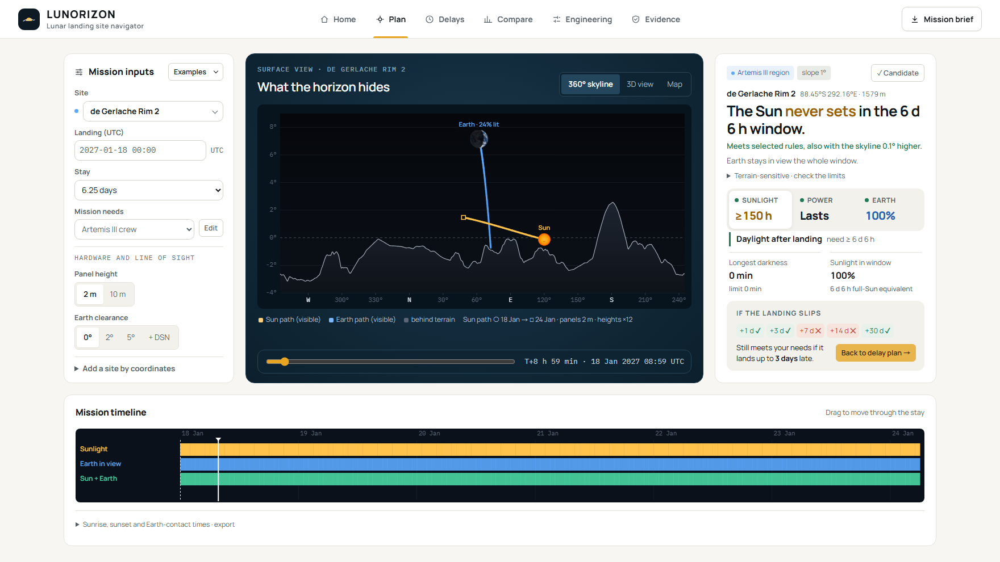
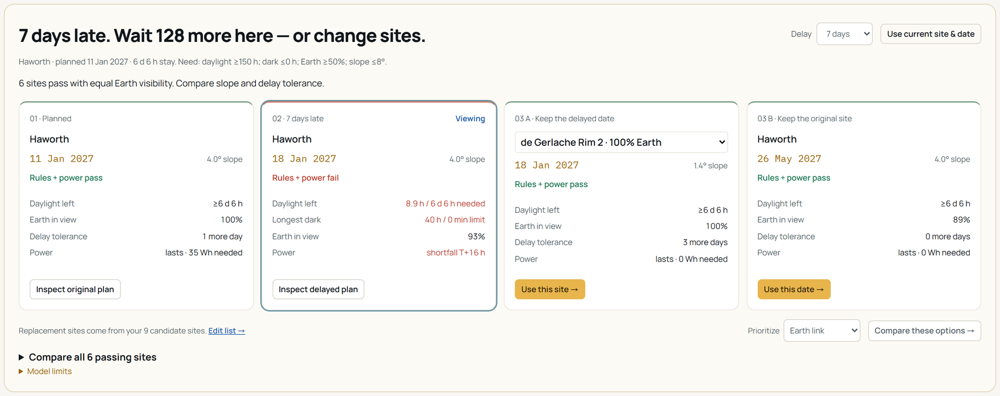

# LUNORIZON

**Lunar landing site navigator for the Moon's south pole.** NASA Space Apps Challenge 2026 · Lunar Landing Site Navigator

**[Open LUNORIZON →](https://cs113062273-bot.github.io/NASA-Space-Apps-Challenge-2026/)** — runs in a desktop browser, no login

**[Project demo — seven slides](LUNORIZON_Demo.pdf)**

At the lunar south pole the Sun circles just above the horizon, so a nearby ridge decides when a lander has power. Landing a week late moves those shadows.

LUNORIZON checks sunlight, battery power and Earth contact hour by hour against the real NASA terrain at each site. When a delay breaks the plan, it finds another site that still works that day, or the next date that works at the same site.



## Try it in three clicks

1. On **Home**, choose **Recover a delayed landing**. Haworth, an Artemis III candidate region, is planned for 11 Jan 2027 with a 150-hour crew stay. One week late, the Sun sets behind the terrain after 8.9 hours and the battery runs out at T+16 h.
2. LUNORIZON offers two ways out: six other sites pass on the same day, or Haworth works again on 26 May, 128 days later. Choose **Use this site**.
3. The Plan view plays the stay by itself: the Sun stays above the skyline, the battery holds, and Earth stays in view.



Beyond the story:

- **Plan:** any site and date, with the skyline, a 3D view and maps.
- **Delays:** a 12-month landing-day heatmap and ±500 m touchdown dispersion.
- **Compare:** sites side by side, plus a site and date search.
- **Engineering:** landing area and routes, power and temperature, radio and data.
- **Evidence:** real landers and the validation checks.
- **Sharing:** every view is a shareable link, and **Mission brief** exports the decision with its sources and assumptions.

## How it works

- **Terrain:** NASA LRO LOLA elevation models (20 m grid near the pole, coarser elsewhere), and LROC NAC stereo models (3–4 m) at the Athena and Chandrayaan-3 sites. Each site's skyline is traced along 720 rays out to 300 km, including the Moon's curvature.
- **Sun and Earth:** JPL DE440 through NAIF SPICE, hourly 2023–2031, with light time, aberration and Earth parallax. Sunlight is the visible fraction of the solar disk above the skyline, including eclipses by Earth.
- **Power and radio:** solar array, battery and loads hour by hour. The downlink budget uses DSN 34 m antennas, and each antenna must see the Moon and clear the lunar skyline.
- **In the browser:** everything runs client-side in TypeScript (React, Vite, three.js). The Python pipeline in `lunar/pipeline` precomputes terrain tiles, horizons and ephemerides.

## Validation

| Check | Result |
|---|---|
| Sun and Earth positions vs JPL Horizons, 40 cases | max error 0.00003° |
| Sunlight vs NASA Goddard's polar illumination map, 300 points | 2.46-point RMS difference |
| Earth eclipse at Blue Ghost, 14 Mar 2025 | all four contacts within 4 min |
| Odysseus first light after its night | same day operators began listening, 20 Mar 2024 |
| Average sunlight at Connecting Ridge C2 vs Gläser et al. (2018) | 78.1%, same as published |

Every check, with its method, scope and what it does not cover, is in [lunar/VALIDATION.md](lunar/VALIDATION.md). Results are in `lunar/data/validation/`.

**Limits:** features smaller than the terrain grid (boulders, small craters) are not modelled. Lander tilt and self-shadowing are omitted. Power, thermal and radio results depend on the hardware assumptions you set. DSN results are geometric and do not include real antenna bookings. This is a planning and education tool, not flight-certified analysis.

## Run locally

Requires Node.js 22.12 or newer.

```bash
git clone https://github.com/cs113062273-bot/NASA-Space-Apps-Challenge-2026.git
cd NASA-Space-Apps-Challenge-2026/lunar/app
npm ci
npm run dev -- --port 5180
```

Open http://127.0.0.1:5180/. All runtime data is committed under `lunar/app/public`. No API key, backend or Python is needed.

**Tests** (from `lunar/app`):

- `npm test` runs 226 unit tests.
- `npx playwright install chromium`, then `npm run test:browser`, runs 42 desktop browser checks.

Python regressions run from `lunar` with `python -m unittest discover -s pipeline -p "test_*.py"`.

**Rebuild the data (optional):** the scripts in `lunar/pipeline` fetch the NASA and NAIF sources and rebuild everything in `lunar/app/public/data`. Install them with `pip install -r lunar/pipeline/requirements.txt`. The raw downloads are several GB and are not committed.

## Data and credits

**[Complete data, reference and software credits](SOURCES.md)**

- **NASA LRO LOLA** elevation models (PDS Geosciences Node).
- **LROC NAC** stereo terrain (NASA / Arizona State University).
- **NASA Goddard PGDA** illumination maps.
- **LRO Diviner** temperatures.
- **NASA/JPL NAIF SPICE** kernels (DE440), with **JPL Horizons** as an independent check.
- **Artemis III** candidate regions: NASA, October 2024.
- **Photos:** Sun from NASA SDO and Earth from Apollo 17, both NASA.
- **Wheel-soil model:** adapted from RoverDevKit (MIT); see [THIRD_PARTY_NOTICES.md](lunar/app/THIRD_PARTY_NOTICES.md).
- **Fonts:** Manrope and IBM Plex Mono (SIL OFL).

Lander outcomes and site coordinates are cited in the app next to each number.

**Use of AI:** the code, data pipeline and text were written with AI coding assistants (Claude, OpenAI Codex). No value shown in the app is generated by AI at runtime, and no AI-generated images are used.

Team LUNORIZON · Chin Hao Hsu. Not affiliated with or endorsed by NASA.
